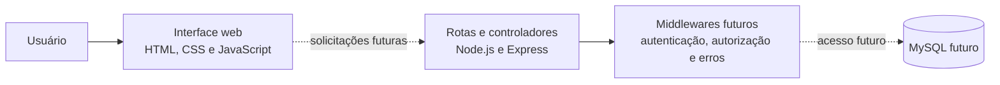

# ReViva — Plataforma de Incentivo à Reciclagem

> **Atividade 1 — Problema e estrutura inicial do projeto web**
> Este repositório registra a proposta e a estrutura inicial do ReViva. As funções descritas como planejadas ainda não estão implementadas.

## Contexto e problema

O descarte inadequado de resíduos está ligado, entre outros fatores, à dificuldade de saber como separar determinados materiais e onde destiná-los. Mesmo quando existem iniciativas e pontos de recebimento, as informações podem estar dispersas. Também é difícil para uma pessoa acompanhar o que reciclou e perceber a continuidade de sua participação.

O problema que o ReViva pretende enfrentar reúne três aspectos: descarte inadequado de resíduos, dificuldade para encontrar informações confiáveis sobre locais de coleta e falta de acompanhamento das atividades de reciclagem. É uma questão que envolve materiais cotidianos — plástico, papel, metal e vidro, entre outros — e não se limita a resíduos eletrônicos.

São afetados cidadãos que procuram descartar resíduos corretamente, comunidades que organizam ações locais, pontos de coleta que precisam comunicar endereços e materiais aceitos, e organizações interessadas em sustentabilidade. A ausência de informação organizada pode dificultar tanto a decisão individual quanto a articulação dessas iniciativas.

## Justificativa

Uma plataforma digital pode reunir orientações sobre materiais e informações sobre pontos de coleta em um local de consulta acessível. Ao registrar atividades de reciclagem, a plataforma poderá organizar um histórico pessoal e, a partir de registros válidos, apresentar pontos, metas e indicadores. Essa combinação aproxima informação e ação: a pessoa consulta o destino adequado, registra sua participação e acompanha sua evolução.

O incentivo não depende apenas de pontuação. A proposta integra consulta, registro e acompanhamento para apoiar a formação de hábitos sustentáveis, enquanto informações organizadas também podem ajudar comunidades e organizações a compreender a participação registrada. Os indicadores serão apresentados como resultados dos dados efetivamente armazenados; não se presume impacto nem se atribuem resultados antes da implementação e validação do sistema.

## Proposta e objetivos

**Objetivo geral:** desenvolver uma plataforma web que incentive a reciclagem e facilite o acompanhamento das atividades sustentáveis dos usuários.

**Objetivos específicos:**

- Facilitar a consulta de materiais recicláveis e de orientações para sua destinação.
- Organizar informações sobre pontos de coleta, incluindo endereços e materiais aceitos.
- Permitir o registro e o acompanhamento de reciclagens.
- Incentivar a participação por meio de pontuação e metas relacionadas aos registros válidos.
- Apresentar indicadores calculados a partir dos registros do sistema.
- Preparar a plataforma para futuras iniciativas de reutilização e economia circular.

## Escopo por etapa

### 1. Funcionalidades essenciais da proposta

São os componentes que dão sentido à solução e orientam o desenvolvimento:

- Consulta de materiais recicláveis, contemplando categorias como plástico, papel, metal e vidro.
- Consulta de pontos de coleta, seus endereços e os materiais recebidos em cada local.
- Registro de reciclagens com material, quantidade e local, associado à pessoa responsável.
- Histórico para consulta das quantidades e da evolução ao longo do tempo.
- Pontuação calculada automaticamente no back-end segundo o material e a quantidade registrados.
- Metas e desafios cujo progresso considera registros válidos.
- Indicadores de quantidade reciclada, materiais mais registrados e evolução mensal, derivados dos dados do sistema.

Esses itens compõem a proposta do produto; nesta Atividade 1, não estão funcionais. A implementação será distribuída pelas próximas entregas.

### 2. Funcionalidades planejadas para as próximas entregas

- Banco de dados e relacionamento entre os registros da plataforma.
- Criação de conta, login, proteção de senhas, autenticação JWT e autorização por perfil.
- Operações de cadastro, consulta, edição e exclusão (CRUD) para os recursos definidos no escopo.
- Integração entre interface e back-end, validações e regras de negócio.
- Histórico pessoal, cálculo de pontos, metas e indicadores com dados persistidos.
- Fluxos administrativos para manter materiais, pontos de coleta e, caso sejam mantidos, desafios.

### 3. Expansões futuras

- Reutilização e doação de objetos em boas condições, conectando pessoas interessadas em prolongar sua vida útil.
- Recursos adicionais de economia circular que complementem a reciclagem com reaproveitamento e circulação responsável de bens.

Essas expansões dependem de planejamento próprio e não fazem parte das funcionalidades implementadas nesta etapa.

## Perfis e responsabilidades previstas

### Usuário comum

- Criar uma conta e acessar a plataforma.
- Consultar materiais recicláveis e pontos de coleta.
- Registrar reciclagens e consultar o próprio histórico.
- Acompanhar pontos, metas e indicadores pessoais disponíveis.

### Administrador

- Gerenciar informações de materiais recicláveis e pontos de coleta.
- Consultar informações gerais autorizadas.
- Gerenciar desafios, caso sejam incluídos no escopo.
- Acompanhar indicadores gerais autorizados.

Os perfis têm responsabilidades diferentes porque o usuário comum consulta e registra suas próprias atividades, enquanto o administrador mantém informações de referência compartilhadas e acompanha dados gerais conforme sua autorização. Essa separação protege registros pessoais e reduz alterações indevidas em dados usados por toda a comunidade. A autenticação e o controle efetivo das permissões serão implementados nas próximas entregas; ainda não existem nesta etapa.

## Fluxos previstos

### Fluxo do usuário

1. A pessoa acessa a plataforma.
2. Cria uma conta ou realiza login.
3. Acessa seu painel pessoal.
4. Consulta materiais recicláveis e pontos de coleta.
5. Registra uma reciclagem informando material, quantidade e local.
6. O sistema valida o registro e calcula a pontuação no back-end.
7. O histórico é atualizado com o registro válido.
8. A pessoa acompanha pontos, metas e indicadores disponíveis.

O fluxo descreve o comportamento futuro. A criação de conta, o login, o painel, os registros e seus cálculos não são funcionais na Atividade 1.

### Fluxo administrativo

O administrador autenticado deverá consultar as informações de referência, cadastrar ou atualizar materiais e pontos de coleta, incluindo endereços e materiais aceitos, e verificar informações gerais permitidas. Se os desafios forem mantidos no escopo, poderá também organizá-los e acompanhar indicadores gerais. As operações deverão respeitar permissões e validações definidas nas próximas etapas.

## Regras de negócio planejadas

As regras abaixo orientarão a implementação futura e **não estão implementadas nesta atividade**:

- A quantidade reciclada deverá ser maior que zero.
- O material e o ponto de coleta informados deverão existir e estar disponíveis.
- Cada reciclagem deverá estar associada ao usuário responsável.
- A pontuação será calculada no back-end conforme regras definidas para cada material e quantidade.
- O usuário não poderá escolher nem alterar diretamente a própria pontuação.
- Edições ou exclusões de registros deverão recalcular ou ajustar os pontos para preservar a consistência.
- Metas e indicadores deverão ser calculados a partir dos dados registrados e válidos.
- O usuário comum não poderá modificar dados administrativos nem acessar registros privados de outras pessoas sem autorização.

Os critérios exatos de pontuação, disponibilidade, validação e atualização serão definidos junto da implementação das regras de negócio.

## Modelo inicial de dados

Esta é uma proposta conceitual, sem tabelas ou banco funcional. A definição de tabelas, chaves primárias, chaves estrangeiras e restrições será feita na **Atividade 2**.

| Entidade | Informações previstas | Relações previstas |
|---|---|---|
| `usuarios` | Identificação, dados de acesso protegidos e perfil de acesso. | Um usuário poderá possuir vários registros de reciclagem e participar de desafios. |
| `materiais` | Nome, categoria, orientação de separação e regra de pontuação aplicável. | Um material poderá aparecer em vários registros de reciclagem e ser aceito por vários pontos de coleta. |
| `pontos_coleta` | Nome, endereço, informações de funcionamento e situação de disponibilidade. | Um ponto poderá receber vários registros e aceitar diversos materiais. |
| `reciclagens` | Usuário responsável, material, ponto, quantidade, data e pontuação calculada. | Cada registro se relacionará a um usuário, material e ponto de coleta existentes. |
| `desafios` *(se mantidos)* | Descrição, objetivo, período e critérios de conclusão. | Um desafio poderá reunir participantes por meio de `participacoes_desafios`. |
| `participacoes_desafios` *(se necessária)* | Usuário, desafio, progresso e situação da participação. | Relaciona usuários a desafios e pode registrar progresso baseado nas reciclagens válidas. |

A relação entre materiais e pontos de coleta poderá exigir uma associação própria no banco, pois cada ponto pode aceitar vários materiais e um material pode ser aceito em vários pontos. O desenho definitivo será simplificado ou ajustado na Atividade 2 conforme o escopo validado.

## Arquitetura inicial

A interface será separada do servidor. No desenvolvimento futuro, o front-end fará solicitações ao back-end; este aplicará validações e regras de negócio e consultará o banco de dados. Nesta etapa, o diagrama representa uma arquitetura planejada, não uma integração existente:



### Estrutura do projeto

```text
ReViva/
├── backend/
│   ├── src/
│   │   ├── routes/          # definição futura das rotas
│   │   ├── controllers/     # lógica futura das requisições
│   │   ├── middlewares/     # autenticação, autorização e erros futuros
│   │   ├── database/        # conexão futura com MySQL
│   │   ├── app.js           # composição futura da aplicação
│   │   └── server.js        # inicialização futura do servidor
│   └── package.json
├── frontend/
│   ├── index.html           # apresentação inicial do ReViva
│   ├── css/
│   │   └── style.css
│   └── js/
│       └── script.js
├── sql/
│   └── README.md            # planejamento; scripts serão criados na Atividade 2
├── README.md
└── .gitignore
```

As pastas de back-end e SQL são espaços de organização e planejamento. Não contêm nesta etapa uma API integrada nem scripts de criação do banco. Os arquivos de interface apresentam o projeto, sem login, cadastro funcional, painel ou CRUD.

## Cronograma das entregas

1. **Atividade 1:** problema, proposta de solução, funcionalidades, perfis, fluxo e estrutura inicial.
2. **Atividade 2:** banco de dados, cadastro, login, proteção de senhas, JWT e permissões.
3. **Atividade 3:** CRUD completo, integração com Fetch, manipulação do DOM e regras de negócio.
4. **Atividade 4:** finalização, testes, documentação e apresentação.

## Verificação dos indicadores da avaliação

| Indicador | Situação nesta proposta |
|---|---|
| **1 — Problema** | Documentados problema, contexto, público afetado e justificativa, sem estatísticas inventadas. |
| **2 — Solução** | Definidos objetivos, funcionalidades por etapa, perfis, responsabilidades, fluxos e regras futuras. |
| **3 — Estrutura** | A estrutura local contempla front-end, back-end, SQL e separação entre rotas, controladores, middlewares e banco. Os arquivos iniciais ainda precisam ser adicionados ao histórico Git para aparecerem no repositório remoto. |
| **4 — GitHub** | Git já estava configurado na branch `main`, com remoto `origin` apontando para `Luizahw/ReViva` e o commit inicial `2cefc6d`. As alterações desta atividade estão no diretório de trabalho, mas ainda não foram commitadas nem enviadas ao GitHub. |

## Git e publicação

O histórico encontrado contém somente o commit inicial `2cefc6d` (`Initial commit`). Nenhum commit desta atividade foi criado durante a preparação dos arquivos. Para registrar as alterações após revisá-las, use, por exemplo:

```bash
git status
git add README.md .gitignore frontend backend sql
git commit -m "docs: documenta proposta inicial do ReViva"
git push origin main
```

O último comando publica o commit no remoto configurado; ele só deve ser considerado concluído após execução bem-sucedida. O projeto deve manter este único repositório GitHub durante as quatro entregas.
